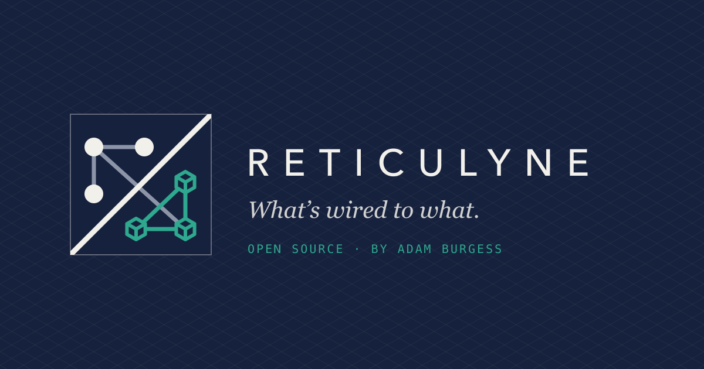
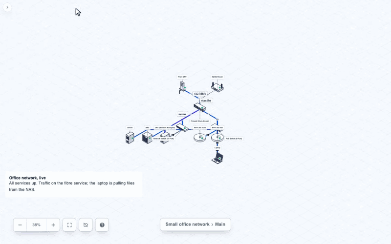
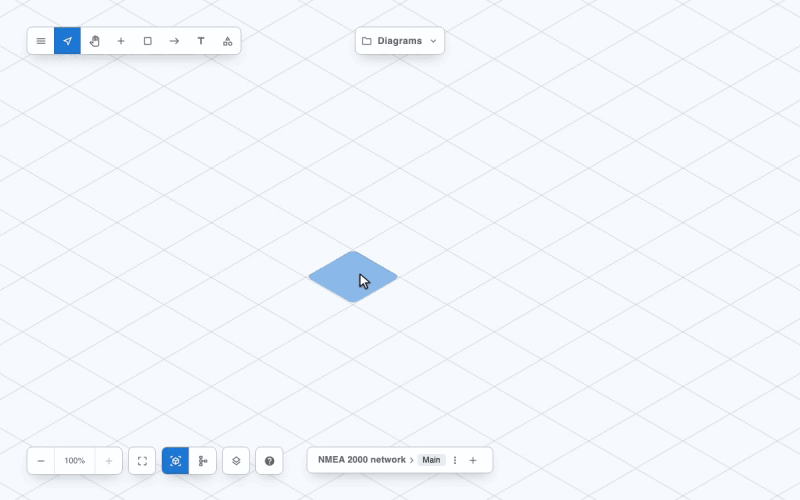

<p align="center">
  <a href="https://reticulyne.com"></a>
</p>

# Reticulyne

Reticulyne is an open-source editor for network diagrams, drawn on an isometric grid
or as a flat schematic. It is a React component you embed in your own application, and
it also runs on its own as a self-hosted editor. Use it for infrastructure topologies,
software architecture, comms rooms, building systems, and the networks on boats and in
vehicles, where the catalogue of devices and their ports does the fiddly part for you.

**Project site:** [reticulyne.com](https://reticulyne.com)

[](LICENSE)
[](https://www.npmjs.com/package/@reticulyne/editor)

## See it in action

Three recordings of the editor itself, driven the way a person uses it.

### Drawing a small office network

Devices are dragged in from the catalogue and connected from their context menu. Each
connection takes a real port on a real medium, and the inspector lets you choose a
different port, or move a device's label to any of eight points around it. At the end
the same diagram is shown as a flat schematic and back.


### The same network as a live status board

An embedding application drives the diagram from its own data: traffic animates along
the links, status pips sit on the devices, readings sit on the links, and the story of
a fibre outage, a failover to 4G and a mains failure carried by the UPS plays out. Part
way through the labels are hidden, so only the network shows.



### An NMEA 2000 network on a boat

A backbone of tees between two terminators, a power injector, and the instruments on
the drops. The catalogue knows the bus rules, so the inspector warns about the missing
terminator and the missing bus power until the backbone is complete.



The recordings are made by scripts in [`demos/`](demos/README.md), so a change to the
editor that breaks one of these flows fails the recording.

## Features

- **Drag-and-drop editing** of icons, regions and connectors on an isometric grid, with
  connectors routed along the grid and its diagonals.
- **Isometric or flat, per view.** The same diagram drawn isometrically or as a flat,
  Visio-style schematic, switched from the toolbar. Nothing moves, because both draw
  the same tiles, and every icon carries a drawing for each.
- **A catalogue of real devices.** Switches, firewalls, access points, cameras, panels,
  marine instruments and more, each with its ports, media and protocols. Connecting two
  devices picks matching ports, and the editor warns when a bus is missing a terminator
  or a loop is not closed. See [Catalogue](docs/catalogue.md).
- **Floors.** A diagram's views are its floors; the others are drawn faintly above and
  below the one on show, and a link to another floor is drawn as a stub that takes you
  there.
- **Labels where you want them.** Each device's label sits at any of eight compass
  points around it, and the whole set can be hidden with a click or `Alt+L`.
- **Icon packs.** Bring your own icons beside the built-in drawings, each with an
  isometric and a flat view. See [Icon packs](docs/icon-packs.md).
- **Editor modes** for an editor, a viewer and a non-interactive render.
- **One file format.** Diagrams open and save as the
  [Reticulyne scene format](docs/scene-format.md), one JSON document with a published
  schema that also carries floor plans and object details the editor does not show.
- **Export** to JSON, PNG, PDF, SVG and Mermaid, entirely in the browser.
- **Mermaid flowcharts in and out.** Import a Mermaid flowchart as a laid-out diagram, with
  any mistake in it shown at its line and column, and export a view as flowchart text that
  GitHub and every Mermaid renderer draw.
- **Live dashboards.** Animate connectors, fire signal pulses and overlay your own
  status indicators from a poller or a websocket. See
  [Live dashboards](docs/embedding.md#live-dashboards).

## Getting started

```bash
npm install @reticulyne/editor react react-dom \
  @mui/material @mui/icons-material @emotion/react @emotion/styled zustand
```

```tsx
import Reticulyne from '@reticulyne/editor';

export function Diagram() {
  return (
    <div style={{ width: '100%', height: 600 }}>
      <Reticulyne />
    </div>
  );
}
```

The package is on npm as
[`@reticulyne/editor`](https://www.npmjs.com/package/@reticulyne/editor) and needs
React 19, MUI v9, Emotion and Zustand beside it; see [Installation](docs/installation.md)
for versions and browser support. To run the editor on its own instead, see
[Standalone Docker](docs/docker.md).

## Documentation

- [Quick start](docs/quickstart.md): a minimal embed, container sizing, Next.js notes
- [API reference](docs/api.md): every prop, plus the `useReticulyne()` hook
- [Embedding](docs/embedding.md): modes, host-managed save, callbacks, live dashboards, the security model
- [Catalogue](docs/catalogue.md): the devices, their ports, media and protocols
- [Icon packs](docs/icon-packs.md): icons with isometric and flat drawings, bundled and your own
- [Scene format](docs/scene-format.md): the file format
- [Mermaid](docs/mermaid.md): flowcharts in and out, every shape, link and error
- [Keyboard shortcuts](docs/keymap.md): the full keymap
- [Standalone Docker](docs/docker.md): run the editor as a self-hosted app
- [Demos](demos/README.md): how the recordings above are made

## Status

Pre-1.0, currently v0.8. The public API is settling, and breaking changes are still
possible between minor versions; each one is recorded in [CHANGELOG.md](CHANGELOG.md).

## Security

Node descriptions are the only rich text, and they are parsed through a schema that
allows only a few inline marks and safe links; the rest is dropped before anything
renders. The full model is in [Embedding: security model](docs/embedding.md#security-model).
To report a vulnerability, see [SECURITY.md](SECURITY.md) rather than opening a public
issue.

## Contributing

Issues and pull requests are welcome.

- **Found a bug, or have an idea or a question?**
  [Open an issue](https://github.com/qant-au/reticulyne/issues/new/choose). For anything
  substantial, open the issue before writing code so we can agree on the scope.
- **Sending a pull request?** Read [CONTRIBUTING.md](CONTRIBUTING.md) for setup, checks
  and conventions.
- **Found a security problem?** Report it privately, as described in
  [SECURITY.md](SECURITY.md).

Everyone taking part is expected to follow the [Code of Conduct](CODE_OF_CONDUCT.md).

## Author

Created, owned and maintained by **Adam Burgess**
([adamburgess.me](https://adamburgess.me)), who is available for customer
implementation work.

## Origins and license

Reticulyne started as a fork of [Isoflow](https://github.com/markmanx/isoflow) by Mark
Mankarious. Released under the [MIT License](LICENSE), which carries both copyright
notices.
