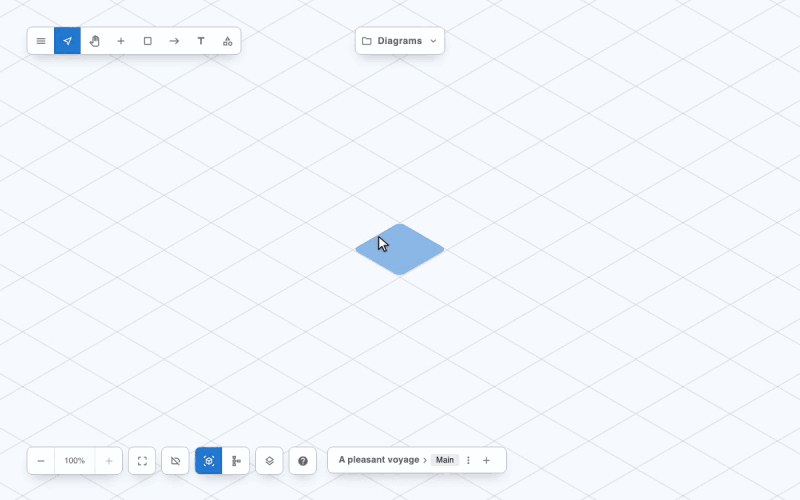

# Icon Packs

An **icon pack** is a set of icons that Reticulyne can draw, with the ports of the devices they
draw, in one file. Reticulyne's own drawings ship as a pack, and anyone can make one: your own
equipment, a vendor's set you have the right to use, a house style. A pack can be used three
ways:

- **Installed by hand**, from the editor's **Icon packs** dialog.
- **Pushed in from code**, by the app that embeds the editor, and locked there if the app wants
  only its own icons.
- **Shared** with others: a pack says where it comes from, and a diagram drawn with it says
  which packs it used, so whoever opens the diagram knows what to install.



The [Nautical Flags](../packs/nautical-flags) pack in this repository is a worked example used
throughout this page: the 40 flags of the International Code of Signals, each drawn isometric
and flat, clipping together by a halyard.

## What a Pack Is

A pack is one JSON file holding everything: the pack's details, any media its devices connect
on, and every icon with both its drawings and its ports.

```ts
type IconPack = {
  id: string;          // stable; the library section its icons are filed under
  name: string;
  version?: string;
  sourceUrl: string;   // where to get it, or find out more; required
  media?: Medium[];    // media the pack's own devices connect on
  icons: PackIcon[];   // ids unique within the pack
};

type PackIcon = {
  id: string;           // start it with the pack id: 'nautical-flags-alfa'
  name: string;
  url: string;          // the isometric drawing (with isIsometric: true)
  isIsometric?: boolean;
  flatUrl?: string;     // the flat (2D, schematic) drawing
  collection?: string;  // a library section of its own, instead of the pack's
  // Connection detail, for a device that connects:
  family?: Family;      // its palette section
  description?: string;
  ports?: PortTemplate[];
  props?: Record<string, string | number | boolean>;
};
```

- **`sourceUrl`** is required and is any non-empty text: the pack's repository, a web page, or a
  sentence saying who to ask. It is shown to everyone who installs the pack, and to anyone who
  opens a diagram drawn with it without having it. Reticulyne never fetches or checks it.
- **`url` and `flatUrl`**: the isometric view draws `url`, the flat view draws `flatUrl`, or
  `url` when there is none. Each is an `http(s):`, `blob:` or relative URL, or a
  `data:image/...` URI, at most 65,536 characters.

The JSON Schema of a pack is published with the package at
`dist/schema/icon-pack.json` ([`ICON_PACK_SCHEMA_URL`](#helpers)), for checking a pack in any
language. `validateIconPack` does that and checks the ports too.

## Connection Detail

Connections are described in two places, and which one depends on whose icon it is.

| | Built-in icons | Pack icons |
|---|---|---|
| Where the ports live | In the [catalogue](catalogue.md): `src/catalogue/items.ts` | Inline, on each icon in the pack |
| Why | One drawing serves several devices (a 24-port and a 48-port switch share a drawing), so the device is the catalogue item and it names the drawing it uses | A pack brings its own devices; each icon is one device |
| Media | The catalogue's | The catalogue's, plus any the pack declares in `media` |

A pack icon's ports are written exactly as a catalogue item's
([Ports](catalogue.md#ports-connector--medium--protocol)): an `id`, optionally a `name`, a
`medium`, and optionally a connector, gender, role, protocols and capabilities. An icon with
ports needs a `family` and a kebab-case id. Each icon with ports becomes a palette item
(`packCatalogueItems(pack)`), so a pack's devices arrive ready to connect.

**A pack's own media.** When none of the catalogue's media fits, a pack declares its own. Signal
flags are not cabled, so the flags pack declares a halyard:

```json
{
  "id": "nautical-flags",
  "name": "Nautical Flags",
  "version": "1.0.0",
  "sourceUrl": "https://github.com/qant-au/reticulyne/tree/main/packs/nautical-flags",
  "media": [
    {
      "id": "halyard",
      "name": "Halyard",
      "family": "marine-vehicle",
      "topology": "point-to-point",
      "connectors": ["snap-shackle"]
    }
  ],
  "icons": [
    {
      "id": "nautical-flags-alfa",
      "name": "Alfa (A)",
      "url": "data:image/svg+xml,...",
      "isIsometric": true,
      "flatUrl": "data:image/svg+xml,...",
      "family": "marine-vehicle",
      "description": "I have a diver down; keep well clear at slow speed.",
      "ports": [
        { "id": "hoist-top", "name": "Hoist top", "medium": "halyard", "connector": "snap-shackle" },
        { "id": "hoist-bottom", "name": "Hoist bottom", "medium": "halyard", "connector": "snap-shackle" }
      ]
    }
  ]
}
```

A medium is written as the catalogue's are ([Media](catalogue.md)). Its id may not be one a
built-in medium already has. Two flags placed and connected join on `halyard`, and the
inspector names the medium "Halyard".

The connection detail stays in the pack. A diagram stores the plain icon record, and a placed
device keeps its own copy of its ports, so it still connects after the pack is gone.

## Making a Pack

`scripts/build-pack.mjs` builds a pack file from a folder of drawings, inlines them, and checks
the result with the library's own `validateIconPack`. It writes nothing unless the pack is valid,
and it lists every problem rather than the first.

```text
my-pack/
  pack.json            { id, name, version, sourceUrl, media?, order? }
  router.iso.svg       the isometric drawing
  router.flat.svg      the flat drawing (optional)
  router.json          { name?, family?, description?, ports?, props? } (optional)
  switch.iso.svg
  ...
```

```sh
node scripts/build-pack.mjs my-pack --out my-pack.reticulyne-pack.json
node scripts/build-pack.mjs my-pack --out my-pack.reticulyne-pack.json --check
```

Every `<name>` becomes the icon `<pack id>-<name>`, named from its `.json` or from `<name>` in
Title Case. `order`, when given, lists every `<name>` in the order the library shows them.
`--check` builds in memory and fails if the file differs, which keeps a committed pack in step
with its drawings. The script needs the package built (`npm run build` in this repository, or
`@reticulyne/editor` installed).

**From a vendor's icon set or your own drawings:**

1. **Check the licence.** Many vendor icon sets carry terms of their own; use only what you have
   the right to use, and say where it comes from in `sourceUrl`.
2. **Draw each icon twice** where you can: an isometric view and a flat, front-on view. An icon
   with only an isometric drawing still works; the flat view draws it as it is, which reads out
   of place. SVG works best.
3. **Give the devices their ports** in `<name>.json`, on the catalogue's media or media the pack
   declares in `pack.json`.
4. **Build and check** with the script. The flags pack is built this way: its
   [`generate.mjs`](../packs/nautical-flags/generate.mjs) writes the drawings and
   [its README](../packs/nautical-flags/README.md) has the commands.

## Installing in the Editor

**Main menu → Icon packs** lists every pack loaded: its version, its source, its number of
icons, and whether you installed it or the app loaded it.

- **Install from file…** reads a pack file. A file with problems lists all of them and installs
  nothing. A pack whose id is already loaded asks first, naming both versions, then replaces it.
- An installed pack's icons are in the library under their own section at once, and its devices
  are in the palette, with no reload.
- The [Docker editor](docker.md) keeps installed packs in the browser (IndexedDB), beside the
  saved diagrams, so they load again next time; in that browser only. A stored pack it can no
  longer read (saved by an older build) is named under the Diagrams button, with **Remove**.
- A pack the app loaded and locked shows "Locked by the app" and has no Remove, and installing
  over it is refused.

The entry is the main menu option `'ACTION.ICON_PACKS'`: on by default, left out like any other
option, and shown only when the diagram is editable.

## Loading Packs in Code

```tsx
import Reticulyne from '@reticulyne/editor';
import flags from './nautical-flags.reticulyne-pack.json';

<Reticulyne
  initialData={scene}
  iconPacks={[{ pack: flags, removable: false }]}
/>
```

Each pack's icons join the library, its devices join the palette after any `catalogueItems`, and
its media join the catalogue's. The `iconPacks` entries:

| Field | Meaning |
|---|---|
| `pack` | The pack. |
| `removable` | `false` locks it: the dialog has no Remove for it and refuses an install over it, and `removeIconPack` refuses too. Use it when the app should draw only the icons it chose. Default `true`. |
| `origin` | `'user'` for a pack the user installed and you kept (shown as "Installed by you"); default `'app'`. |

To keep the user's installs, as the Docker editor does:

```tsx
<Reticulyne
  iconPacks={[...appPacks, ...kept.map((pack) => ({ pack, origin: 'user' }))]}
  onIconPackInstall={(pack) => keep(pack)}       // may return a promise; a rejection is shown
  onIconPackRemove={(id) => forget(id)}
  iconPackUsage={(packId, iconIds) => usageInMyOtherDiagrams(iconIds)}
  onShowIconPackUsage={(diagramId, objectIds) => openAndSelect(diagramId, objectIds)}
/>
```

From code at any time, through `useReticulyne()`:

```ts
const { installIconPack, removeIconPack, getIconPacks } = useReticulyne();
installIconPack(flags, { removable: false }); // { ok, pack } or { ok: false, errors }
removeIconPack('nautical-flags');             // refused for a locked pack
getIconPacks();                               // [{ id, name, version, sourceUrl, icons, origin, removable }]
```

The examples app has a worked version: **Icon Packs from Code** in the examples container
(`src/examples/IconPacks`), which loads the flags pack locked and draws a hoist.

### Loading Rules

- **The last pack loaded with an id wins.** An install replaces an earlier pack of the same id,
  whether the app or the user loaded it.
- **Except a locked pack**, which is never replaced or removed from the editor.
- Removing a pack takes its icons out of the library, except any an object on the canvas still
  draws with.

### Helpers

From `@reticulyne/editor` and `@reticulyne/editor/standalone`:

| Export | Does |
|---|---|
| `validateIconPack(value)` | Checks a parsed value against the pack schema (strict: unknown fields are refused), that ids are unique, that media do not clash with the catalogue's, and that every port is valid. Returns `{ ok: true, pack }` or `{ ok: false, errors }`. |
| `iconPackSchema`, `packIconSchema` | The Zod schemas behind it. |
| `ICON_PACK_SCHEMA_URL` | Where the pack's JSON Schema is published. |
| `packIcons(pack)` | The pack's icons as plain icon records, each without a `collection` filed under the pack id. |
| `packCatalogueItems(pack)` | A catalogue item for each icon with ports. |
| `packMedia(pack)` | The media the pack declares. |
| `flattenPacks(packs)` | Every pack's icons as one `Icon[]`; the first icon of an id wins. |
| `fillFlatUrls(icons, library)` | Gives each icon with no `flatUrl` the one of the same id in `library`. |
| `BUILTIN_PACK`, `builtinIcons()` | Reticulyne's own drawings. |

## Removing a Pack

**Remove** asks first. It is refused while any diagram places an object drawn with the pack's
icons. The refusal lists each diagram and the objects in it; **Show** opens that diagram with
those objects selected, so they can be deleted or given another icon. Once nothing uses the
pack, Remove goes ahead.

The editor checks the diagram that is open. The Docker editor also checks every diagram saved in
the browser; another host answers for its diagrams through `iconPackUsage`. Only objects placed
on a view count: one on no view cannot be seen or deleted, and it carries its own copy of the
icon anyway.

## Sharing a Diagram

A diagram keeps its own copy of every icon it uses, both drawings, so it draws anywhere. When it
is saved or exported, it also lists each pack it used, once:

```json
"externalPacks": [
  {
    "id": "nautical-flags",
    "name": "Nautical Flags",
    "version": "1.0.0",
    "sourceUrl": "https://github.com/qant-au/reticulyne/tree/main/packs/nautical-flags",
    "icons": ["nautical-flags-alfa", "nautical-flags-zulu"]
  }
]
```

Opened somewhere without that pack, the editor says so, links the source, and draws the icons
from the copies in the file. Installing the pack takes the message away and brings the devices'
ports into the palette. A pack installed at another version than the diagram lists is named
too. See [Packs a diagram uses](scene-format.md#packs-a-diagram-uses).


## Missing Icons

An object whose icon is neither in its diagram nor in the editor's library (a file edited by
hand, an icon renamed in a pack) opens as a question mark, in both views, instead of the whole
file being refused. The message lists each missing icon and how many objects use it:

- **Replace…** redraws every object using it with an icon from the library, as one undo step.
  Ports and connections are kept.
- To change one object only, select it and use **Update icon** in its inspector.
- Installing a pack that has the icon brings it back.

The placeholder is saved with the diagram, which keeps the file valid, and the icon is reported
as missing again the next time the diagram opens.

## The Built-in Pack

`BUILTIN_PACK` (id `reticulyne`) holds Reticulyne's device drawings (`src/icons/drawings.ts`):
network, security, fire, AV and power equipment, each with an isometric view as `url` and a flat,
front-on schematic as `flatUrl`. The icons are `reticulyne-<drawing id>`, filed under
`Reticulyne`. The [catalogue](catalogue.md) items draw with them: an item names its drawing with
`drawing`. Built-in icons are not listed in a diagram's `externalPacks`.

## One Object's Own Images

To change how a single object looks without touching the library, select it and use **Icon
images** in its inspector: **Upload** an isometric image, a flat one, or both. Each replaces
that object's drawing in its own view only, and **Remove** brings the icon's drawing back.

- The icon in the library, and every other object drawn with it, stays as it is.
- The object keeps its ports, so what it can connect to does not change.
- Copy and paste carries the images to the copy; the same device placed again from the
  library starts with the library's drawing.
- Uploads go through the host's `onIconUpload`, as **Upload icon** does, with the same
  checks (SVG, PNG, JPEG, GIF or WebP, at most 200 KB, an image the browser can draw). With
  no `onIconUpload` there is no Upload, but an object that already has images can still
  have them removed.
- In the file they are the object's `iconOverride` ([scene format](scene-format.md#objects)).

## Best Practice

- **Stable ids.** Diagrams name icons by `id`; renaming one turns it into a missing icon in every
  diagram that uses it. Prefix a pack's ids with the pack id so two packs never collide.
- **Version the pack** and change `version` with every release, so a diagram drawn with an older
  one says which.
- **Give every icon both drawings** where you can.
- **Mind the size.** Inline SVG keeps a pack in one file (the 40-flag pack is about 120 KB).
  Very large raster images make every diagram that uses them larger too.
- **Set the right CSP** if your icons are served from elsewhere: the standalone Docker container
  allows images only from `'self'`, `data:` and `blob:` (see [docker.md](docker.md)).
