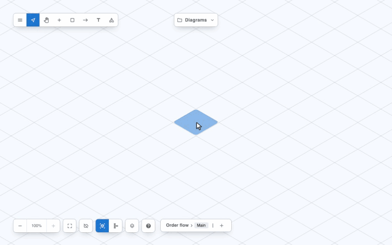
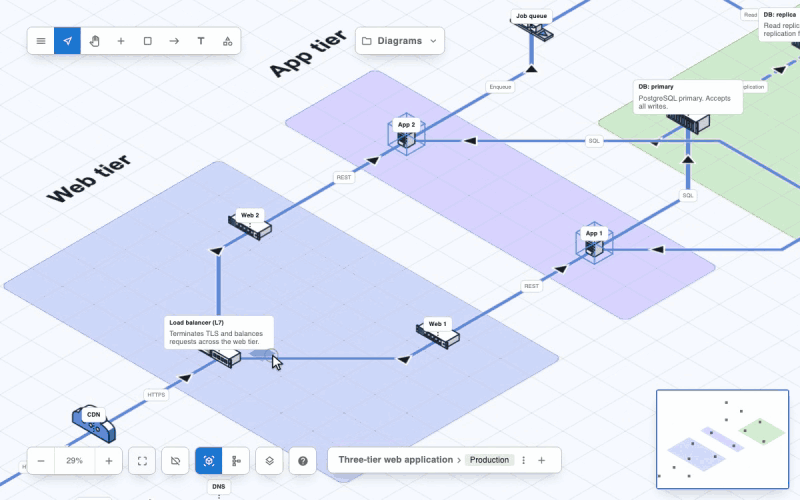

# Mermaid Import and Export

Reticulyne reads and writes [Mermaid](https://mermaid.js.org/) **flowcharts**: the
`flowchart` (or `graph`) diagram type. A diagram view exports as flowchart text that GitHub,
GitLab and every Mermaid renderer draw, and a flowchart imports as a diagram, laid out on the
tile grid with each node drawn as its shape.

Both directions work without Mermaid itself: Reticulyne has its own reader for the flowchart
grammar, so nothing extra ships to users and every problem is reported at its line and column.
The test suite checks that reader against Mermaid 11.17 and 12.1 on a corpus of good and broken
flowcharts (`e2e/mermaid-parity.spec.ts`).

- [Importing a Flowchart, Step by Step](#importing-a-flowchart-step-by-step)
- [Exporting a Diagram, Step by Step](#exporting-a-diagram-step-by-step)
- [In the Editor](#in-the-editor)
- [From Code](#from-code)
- [Node Shapes](#node-shapes)
- [Links](#links)
- [Subgraphs, Groups and Zones](#subgraphs-groups-and-zones)
- [Layout on Import](#layout-on-import)
- [What Does Not Carry Across](#what-does-not-carry-across)
- [Errors](#errors)
- [Warnings](#warnings)
- [Limits](#limits)

## Importing a Flowchart, Step by Step



1. Open the **main menu** (top left) and choose **Import Mermaid**.
2. **Paste** the flowchart into the box, or choose **Open file…** and pick a `.mmd`, `.mermaid`,
   `.md` or `.txt` file. From a Markdown file the first ` ```mermaid ` block is read.
3. **Read the line under the box.** "Ready to import: 7 nodes, 7 links." means it is good. If
   anything is wrong, each problem is listed with its line and column, for example
   `Line 11, col 8: "->" is not a Mermaid link. Did you mean "-->"?`, and **Import** stays off.
4. **Choose a problem** in the list: the cursor goes to that place in the text. Fix it there;
   the list updates as you type. [Errors](#errors) lists every message and its fix.
5. Check **Not carried across**, if it appears: click actions, styling and the like are listed
   there ([Warnings](#warnings)). They do not stop the import.
6. Choose **Import**. The flowchart **replaces the diagram** on the canvas, laid out in its
   direction and fitted to the screen: each node drawn as its shape, each subgraph as a group,
   each link as a connector with its label. An import cannot be undone, so export or save the
   diagram first if you want to keep it.

The imported diagram is an ordinary Reticulyne diagram: move, restyle, connect and save it as
any other.

## Exporting a Diagram, Step by Step



1. Show the view (floor) to export: the export writes the **current view**.
2. Open the **main menu** and choose **Export as Mermaid**. The flowchart text appears at once.
3. Pick the **Direction** Mermaid should lay it out in (left to right by default).
4. Tick **Mermaid 11 shapes** only if the text is for a renderer on Mermaid 11 or later; left
   off, every shape is written in the bracket form every renderer reads, GitHub's included.
5. If the diagram has anything on the Redacted layer, it is left out unless you tick
   **Include redacted content**.
6. Check **Not carried across**: positions, device icons with no flowchart shape, plan views
   and hidden layers stay behind ([What Does Not Carry Across](#what-does-not-carry-across)).
7. **Copy** the text, or **Download .mmd** (the text as it is) or **Download .md** (inside a
   ` ```mermaid ` fence, ready for a README or a wiki page).

Paste the text into any Markdown file on GitHub or GitLab, or into the
[Mermaid Live Editor](https://mermaid.live/), and Mermaid draws it.

## In the Editor

Two entries in the main menu, both on by default (`mainMenuOptions`: `'ACTION.IMPORT_MERMAID'`
and `'EXPORT.MERMAID'`):

- **Import Mermaid** opens a box to paste a flowchart into, or **Open file…** for a `.mmd`,
  `.mermaid`, `.md` or `.txt` file. A Markdown file is read for its first ` ```mermaid ` block.
  The text is checked as it is typed: every error is listed as `Line 4, col 9: …`, and choosing
  one puts the cursor there. **Import** stays off until there are no errors; then the flowchart
  **replaces the diagram** on the canvas, fitted to the screen. A flowchart with no `title` of its own
  takes the opened file's name, or keeps the diagram's current title. What did not carry across is
  listed under the box before you import.
- **Export as Mermaid** shows the current view as flowchart text, with a **direction** (left to
  right, top to bottom, and the reverse of each), **Mermaid 11 shapes** (see
  [Node Shapes](#node-shapes)), and, when the diagram has anything on the Redacted layer, the
  usual opt-in to include it. **Copy** puts the text on the clipboard; **Download .mmd** saves
  it as it is, **Download .md** inside a ` ```mermaid ` fence. A list says what did not carry
  across.

## From Code

The functions are framework-free and exported from `@reticulyne/editor/standalone`, so they run
in Node, a worker or a build step as well as the browser:

```ts
import {
  sceneToMermaid,
  mermaidToScene,
  parseMermaid,
  formatIssue
} from '@reticulyne/editor/standalone';

// A scene (or a legacy model) to flowchart text.
const { text, warnings, stats } = sceneToMermaid(scene, {
  view: 'net-ground',   // a diagram view's id; the first iso/schematic view if absent
  direction: 'LR',      // 'LR' (default) | 'TB' | 'RL' | 'BT'
  syntax: 'classic',    // 'classic' (default) | 'extended'
  zoneTitles: true,     // a text box near a zone titles it (default true)
  ports: false,         // port names in link labels (default false)
  markdown: false       // wrap in a ```mermaid fence
});

// Flowchart text (or Markdown) to a scene. `scene` is absent when there are errors.
const { scene, issues } = mermaidToScene(text, {
  title: 'Fallback title',   // when the flowchart has none
  id: 'my-diagram',          // the scene id (default 'mermaid-import')
  view: 'iso'                // 'iso' (default) | 'schematic'
});
for (const issue of issues) console.log(formatIssue(issue));
// Line 2, col 5: "->" is not a Mermaid link. Did you mean "-->"?
```

`sceneToMermaid` leaves redaction to you, as the other exports do: pass
`redactScene(scene)` unless the Redacted layer should go out. It throws only when handed
something that is not a diagram.

Inside an editor, `useReticulyne()` has the same two directions bound to the open diagram (see
the [API reference](api.md#usereticulyne--imperative-hook)):

```ts
const { exportMermaid, importMermaid } = useReticulyne();
const { text } = exportMermaid({ direction: 'TB' });          // current view, redacted
const { ok, issues } = await importMermaid(pastedText);        // replaces the diagram
```

`parseMermaid(text)` returns the parsed flowchart (nodes, links, subgraphs) and the issues,
for a host that wants to validate text or build something else from it.

Every issue has the same shape:

```ts
interface MermaidIssue {
  code: string;                // 'MMD_BAD_ARROW', 'MMD_CLICK_DROPPED', ...
  severity: 'error' | 'warning';
  message: string;             // one plain line saying what is wrong here
  line?: number;               // 1-based, in the text as given (a Markdown file's own lines)
  column?: number;
  excerpt?: string;            // the text at that place
  count?: number;              // a warning that occurred more than once
}
```

## Node Shapes

Every Mermaid flowchart shape has a row here, all 53 of Mermaid 11 and 12; a test reads the
list out of the installed Mermaid packages so a shape added upstream fails the build rather than
importing as a guess.

- **Import** draws a node with its shape's drawing. Most shapes have a drawing of their own in
  the **Flowchart** family of the [catalogue](catalogue.md#flowchart-items); a few share the
  nearest one (*approximate* below). An approximated node records its shape in the object's
  `props` as `mermaid.shape`, so it exports back as the same shape.
- **Export** gives an object the shape its drawing stands for: the flowchart drawings, plus a
  few device drawings with a natural shape (a database is a cylinder, a person a person, a cloud
  service a cloud). Anything else is a plain box (`[ ]`), with an `MMD_ICON_LOST` warning.
- **Classic and extended syntax.** Fourteen shapes have a bracket form (`A{Decision}`) that every
  Mermaid renderer reads. The rest exist only as Mermaid 11's `A@{ shape: doc }`, which older
  renderers refuse. Export writes **classic** syntax by default, putting each extended-only shape
  in its stand-in (the *Classic* column); choose **extended** (the editor's *Mermaid 11 shapes*)
  to keep them. Import reads both.

<!-- shapes:start (generated from src/mermaid/shapes.ts by src/mermaid/__tests__/docs.test.ts; do not edit) -->
| Shape | Means | Also accepted as | Brackets | Drawing | Classic |
|---|---|---|---|---|---|
| `rect` | Process | `proc`, `process`, `rectangle`, `squareRect` | `[ ]` | `flow-process` | |
| `rounded` | Event | `event`, `roundedRect` | `( )` | `flow-event` | |
| `stadium` | Terminal point | `terminal`, `pill` | `([ ])` | `flow-terminal` | |
| `fr-rect` | Subprocess | `subprocess`, `subproc`, `framed-rectangle`, `subroutine` | `[[ ]]` | `flow-subprocess` | |
| `cyl` | Database | `db`, `database`, `cylinder` | `[( )]` | `flow-database` | |
| `datastore` | Data store | `data-store` | | `flow-data-store` | `cyl` |
| `folder` | Folder | `directory` | | `file-share` | `rect` |
| `bucket` | Bucket | | | `object-storage` | `cyl` |
| `console` | Console (terminal window) | | | `flow-console` | `rect` |
| `browser` | Browser | | | `website` | `rect` |
| `person` | Person | | | `user` | `rounded` |
| `circle` | Start | `circ` | `(( ))` | `flow-start` | |
| `bang` | Bang | | | `alert` | `hex` |
| `cloud` | Cloud | | | `cloud-service` | `rounded` |
| `diam` | Decision | `decision`, `diamond`, `question` | `{ }` | `flow-decision` | |
| `hex` | Prepare conditional | `hexagon`, `prepare` | `{{ }}` | `flow-prepare` | |
| `lean-r` | Data input/output | `lean-right`, `in-out`, `lean_right` | `[/ /]` | `flow-data-io` | |
| `lean-l` | Data output/input | `lean-left`, `out-in`, `lean_left` | `[\ \]` | `flow-data-io` (approximate) | |
| `trap-b` | Priority action | `priority`, `trapezoid-bottom`, `trapezoid` | `[/ \]` | `flow-priority` | |
| `trap-t` | Manual operation | `manual`, `trapezoid-top`, `inv-trapezoid`, `inv_trapezoid` | `[\ /]` | `flow-manual-operation` | |
| `dbl-circ` | Stop | `double-circle`, `doublecircle` | `((( )))` | `flow-stop` | |
| `text` | Text block | | | `flow-text` | `rect` |
| `notch-rect` | Card | `card`, `notched-rectangle` | | `flow-card` | `rect` |
| `lin-rect` | Lined/shaded process | `lined-rectangle`, `lined-process`, `lin-proc`, `shaded-process` | | `flow-lined-process` | `rect` |
| `sm-circ` | Start | `start`, `small-circle`, `stateStart` | | `flow-start` (approximate) | `circle` |
| `fr-circ` | Stop | `stop`, `framed-circle`, `stateEnd` | | `flow-stop` (approximate) | `dbl-circ` |
| `fork` | Fork/join | `join`, `forkJoin` | | `flow-fork` | `rect` |
| `hourglass` | Collate | `collate` | | `flow-collate` | `rect` |
| `brace` | Comment | `comment`, `brace-l` | | `flow-comment` | `rect` |
| `brace-r` | Comment right | | | `flow-comment` (approximate) | `rect` |
| `braces` | Comment with braces on both sides | | | `flow-comment` (approximate) | `rect` |
| `bolt` | Com link | `com-link`, `lightning-bolt` | | `flow-com-link` | `rect` |
| `doc` | Document | `document` | | `flow-document` | `rect` |
| `delay` | Delay | `half-rounded-rectangle` | | `flow-delay` | `rounded` |
| `h-cyl` | Direct access storage | `das`, `horizontal-cylinder` | | `flow-direct-storage` | `cyl` |
| `lin-cyl` | Disk storage | `disk`, `lined-cylinder` | | `flow-disk-storage` | `cyl` |
| `curv-trap` | Display | `curved-trapezoid`, `display` | | `flow-display` | `rect` |
| `div-rect` | Divided process | `div-proc`, `divided-rectangle`, `divided-process` | | `flow-divided-process` | `rect` |
| `tri` | Extract | `extract`, `triangle` | | `flow-extract` | `rect` |
| `win-pane` | Internal storage | `internal-storage`, `window-pane` | | `flow-internal-storage` | `rect` |
| `f-circ` | Junction | `junction`, `filled-circle` | | `flow-junction` | `circle` |
| `notch-pent` | Loop limit | `loop-limit`, `notched-pentagon` | | `flow-loop-limit` | `rect` |
| `flip-tri` | Manual file | `manual-file`, `flipped-triangle` | | `flow-manual-file` | `rect` |
| `sl-rect` | Manual input | `manual-input`, `sloped-rectangle` | | `flow-manual-input` | `rect` |
| `docs` | Multi-document | `documents`, `st-doc`, `stacked-document` | | `flow-documents` | `rect` |
| `st-rect` | Multi-process | `procs`, `processes`, `stacked-rectangle` | | `flow-processes` | `rect` |
| `bow-rect` | Stored data | `stored-data`, `bow-tie-rectangle` | | `flow-stored-data` | `rect` |
| `cross-circ` | Summary | `summary`, `crossed-circle` | | `flow-summary` | `circle` |
| `tag-doc` | Tagged document | `tagged-document` | | `flow-document` (approximate) | `rect` |
| `tag-rect` | Tagged process | `tagged-rectangle`, `tag-proc`, `tagged-process` | | `flow-process` (approximate) | `rect` |
| `flag` | Paper tape | `paper-tape` | | `flow-paper-tape` | `rect` |
| `odd` | Odd | `rect_left_inv_arrow` | `> ]` | `flow-odd` | |
| `lin-doc` | Lined document | `lined-document` | | `flow-document` (approximate) | `rect` |
<!-- shapes:end -->

Device drawings that also export to a shape: `database-service`, `encrypted-database`,
`data-warehouse` and `data-lake` as `cyl`; `user-group`, `administrator` and `guest` as
`person`; `internet`, `private-cloud` and `secure-cloud` as `cloud`.

A node's **label** becomes the object's name: entity codes (`#quot;`, `#9829;`) decoded,
`<br>` read as a line break, Markdown strings (`` "`**bold**`" ``) as plain text, and any other
HTML dropped (never rendered). A label longer than a name's 100 characters is cut, with the
whole text kept as the description. On export a name is always quoted and escaped, so any text
survives the round trip.

Icon and image nodes (`@{ icon: "fa:user" }`, `@{ img: "…" }`) import as plain nodes; the
image is never fetched.

## Links

| Mermaid | Reticulyne connector |
|---|---|
| `-->` | arrow at the end (`START_TO_END`) |
| `---` | no arrow (`NONE`) |
| `<-->` | arrows at both ends (`BOTH`) |
| `-.->`, `-.-` | `DOTTED` |
| `==>`, `===` | thick (width 16; the default is 10) |
| `--o`, `o--o` | a circle end (`glyph: 'circle-outline'`) |
| `--x`, `x--x` | an arrow, with a warning |
| `~~~` | no connector: an invisible link only shapes the layout |
| `-- text -->`, `-->\|text\|` | the label, as the connector's description |
| `--->`, `---->` | a longer link spans more ranks in the layout |
| `e1@-->` with `e1@{ animate: true }` | an animated connector |
| `linkStyle n stroke:#hex` | the connector's colour |
| `linkStyle n stroke-dasharray:…` | `DASHED` |

Chains (`A --> B --> C`) and groups (`A & B --> C & D`) expand to every link they stand for.
A link from a node to itself is left out (a connector cannot loop), with a warning.

On export a connector's label is its description or, when it has none, its connection's name and
medium ("Uplink (Ethernet (fibre))"); `ports: true` adds the port names. A connection with no
connector drawn in the view exports as a dotted link. A connector end that is not on a node, or
a waypoint other connectors join, becomes a small junction node.

## Subgraphs, Groups and Zones

- **Import:** a subgraph becomes a **group** (its title the group's name), nested as written;
  each node joins the innermost subgraph it is first named in, as in Mermaid. A link to a
  subgraph is drawn to its first node, with a warning, because a Reticulyne connector joins
  objects. A subgraph's own `direction` is read but the import lays everything out in the
  flowchart's direction.
- **Export:** a group becomes a dashed subgraph; a zone (rectangle) becomes a subgraph of the
  nodes on its tiles, filled with its colour, and titled by the nearest text box within three
  tiles (`zoneTitles: false` to stop that). Zones and groups nest by what they contain. A
  collapsed group exports as one `[[ ]]` node standing for everything in it, with its links
  re-pointed at it. A text box that titles no zone exports as a note node, tied with `~~~` to the
  nearest node within four tiles.

## Layout on Import

Mermaid lays a flowchart out each time it draws it; a Reticulyne diagram keeps its positions, so
an import chooses them (`src/mermaid/layout.ts`):

1. **Ranks.** Each node sits one rank past every node that links to it, so the flow reads in the
   flowchart's direction. Cycles are broken at the links that close them.
2. **Strips.** Each subgraph gets its own strip across the flow, nested in its parent's, so a
   group's box never takes in another group's nodes.
3. **Order.** Within each rank and strip, nodes are sorted by the mean position of the nodes
   they link to, a few sweeps each way, which takes out most crossings.

Left to right runs along +x (up and to the right in the isometric view, rightwards in the flat
view), top to bottom along −y. Ranks are three tiles apart, and so are nodes side by side in a rank. Import draws
in an isometric view by default; `view: 'schematic'` imports into a flat one.

## What Does Not Carry Across

- **Positions** on export: Mermaid lays the diagram out itself.
- **Device icons** on export: a device with no natural shape is a plain box.
- **Plan views** on export, and anything on a **hidden layer**.
- **Click actions** (`click`, `href`, `call`) on import: dropped, never followed.
- **Configuration** (`%%{init}%%`, a front-matter `config:`) on import. A front-matter `title:`
  is kept, as is `accTitle` / `accDescr`.
- **Node styling** (`style`, `classDef`, `class`, `:::`) on import; link colours and dashes do
  carry across.

Each of these is a warning, never an error.

## Errors

An error stops an import; the scene is not made. Up to twenty errors are collected at once, one
per broken line, so they can all be fixed in one pass.

| Code | Example | What to do |
|---|---|---|
| `MMD_EMPTY` | an empty file, or only comments | Paste or open a flowchart. |
| `MMD_NOT_TEXT` | a PNG opened by mistake | Open the `.mmd` or `.md` file instead. |
| `MMD_TOO_LARGE` | over 1 MB of text, 10,000 nodes or 5,000 links | Split the diagram. |
| `MMD_NO_HEADER` | `A --> B` with no first line; a Markdown file with no mermaid block | Start with `flowchart LR` (or `TB`, …). |
| `MMD_UNSUPPORTED_DIAGRAM` | `sequenceDiagram`, `classDiagram`, `architecture-beta` | Only flowcharts import. |
| `MMD_BAD_DIRECTION` | `flowchart XY` | Use `TB`, `TD`, `BT`, `LR` or `RL`. |
| `MMD_UNCLOSED_SHAPE` | `A[Start --> B` | Close the bracket: `A[Start] --> B`. |
| `MMD_MISMATCHED_BRACKET` | `A[Start)`, `A{Choice]` | Close with the bracket that opened it. |
| `MMD_UNCLOSED_STRING` | `A["Start] --> B` | Close the quote. |
| `MMD_UNCLOSED_SUBGRAPH` | `subgraph S` with no `end` | Add `end`. The message names the subgraph and its line. |
| `MMD_UNEXPECTED_END` | an `end` with nothing open | Remove it, or open the subgraph it closes. |
| `MMD_BAD_ARROW` | `A -> B`, `A <-- B`, `A -- text B` | Use `-->`, `---`, `-.->`, `==>` or `~~~`; a labelled link closes with one. |
| `MMD_DANGLING_EDGE` | `A -->` | Name the node at the other end. |
| `MMD_RESERVED_ID` | `A --> end`, `A --> style` | Rename the node: `End`, `end1`. |
| `MMD_BAD_ID` | `__proto__ --> B` | Use another id. |
| `MMD_UNKNOWN_SHAPE` | `A@{ shape: blob }` | Use a shape from [Node Shapes](#node-shapes). |
| `MMD_BAD_SHAPE_DATA` | `A@{ shape: rect` (no `}`), `A@{ rect }` | Close it, and write `key: value` pairs. |
| `MMD_SUBGRAPH_CYCLE` | two subgraphs each listing the other | Nest one inside the other, not both ways. |
| `MMD_TOO_DEEP` | subgraphs nested more than 32 deep | Flatten the nesting. |
| `MMD_UNEXPECTED_TOKEN` | `A --> B )`, `A[Say "hi"]`, `A --> B %% note`, an unclosed `\|label` or front matter | Remove the stray text; quote a label with quotes in it (`A["Say #quot;hi#quot;"]`); put a comment on its own line. |
| `MMD_INTERNAL` | (should never happen) | The text read correctly but the diagram could not be built: please report it with the text. |

**Stricter than Mermaid, on purpose.** Mermaid draws a few things Reticulyne refuses as
mistakes: two subgraphs inside each other, nesting deeper than 32, `@{ }` entries that are not
`key: value`, and prototype names (`__proto__`, `constructor`, `prototype`) as ids. Everything
else Reticulyne refuses, Mermaid refuses too; `e2e/mermaid-parity.spec.ts` holds the list.

## Warnings

A warning says what did not carry across; the import or export goes ahead. A warning that occurs
more than once is listed once with a count.

| Code | When |
|---|---|
| `MMD_CLICK_DROPPED` | a `click`, `href` or `call` line |
| `MMD_INIT_IGNORED` | `%%{init}%%` or front-matter configuration |
| `MMD_STYLE_PARTIAL` | `style`, `classDef`, `class`, `linkStyle` beyond colour and dashes |
| `MMD_LABEL_TRUNCATED` | a label over 100 characters |
| `MMD_HTML_STRIPPED` | HTML in a label other than `<br>` |
| `MMD_SHAPE_APPROXIMATED` | a shape drawn with the nearest drawing |
| `MMD_IMAGE_NODE` | an `icon:` or `img:` node |
| `MMD_DUPLICATE_LABEL_ID` | a node defined twice with different labels (the last is used) |
| `MMD_EXTRA_FENCES` | a Markdown file with more than one mermaid block |
| `MMD_SELF_LOOP` | a link from a node to itself |
| `MMD_SUBGRAPH_LINK` | a link to a subgraph |
| `MMD_LINK_END_MARKER` | a cross (`x`) link end |
| `MMD_INVISIBLE_LINK` | an invisible link (`~~~`) |
| `MMD_PLAN_VIEW_SKIPPED` | export of a scene with plan views |
| `MMD_HIDDEN_LAYER_SKIPPED` | export with items on hidden layers |
| `MMD_CONNECTION_UNDRAWN` | a connection with no connector in the view |
| `MMD_FREE_CONNECTOR_END` | a connector end not on a node |
| `MMD_POSITION_LOST` | every export with nodes: positions stay behind |
| `MMD_ICON_LOST` | a device icon with no shape |
| `MMD_TEXT_AS_NOTE` | a text box exported as a note |
| `MMD_TOO_BIG_FOR_MERMAID` | output over 50,000 characters or 500 links, Mermaid's own defaults |

## Limits

| | Import | Export |
|---|---|---|
| Text | 1 MB | warns over 50,000 characters |
| Nodes | 10,000 | the view's objects |
| Links | 5,000 | warns over 500 |
| Subgraph nesting | 32 | as deep as the diagram |
| Errors listed | 20 | |
